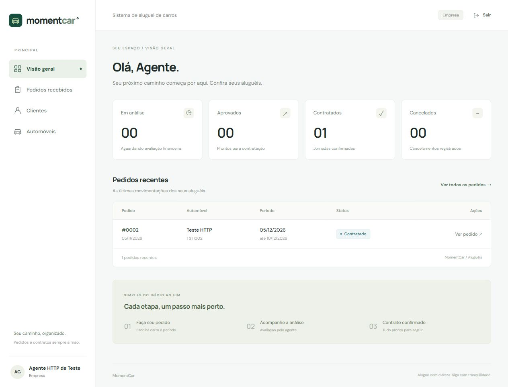

# MomentCar 🚘

Sistema web de aluguel de carros desenvolvido para o LAB02 de Desenvolvimento e Integração de Aplicações Web. Clientes solicitam e acompanham aluguéis; empresas e bancos analisam os pedidos e executam contratos aprovados.

## Status do projeto

Front-end e back-end implementados sobre os projetos base. Build do React/TypeScript e 10 testes Java concluídos com sucesso usando banco de testes H2. **A conexão ao projeto Supabase deve ser configurada pelo usuário** conforme o guia abaixo; não foi verificada com credenciais reais.

## Índice e links úteis

- [Instalação e configuração do Supabase](docs/SUPABASE.md)
- [API e regras de acesso](docs/API.md)
- [Arquitetura, decisões e rastreabilidade](docs/IMPLEMENTACAO.md)
- [Histórias e requisitos](docs/historias_e_requisitos.md)
- [Diagramas originais e versão revisada](docs/diagramas.md)

## Sobre o projeto

O MomentCar reúne cadastro de clientes, identificação de automóveis, pedidos, análises financeiras e contratos. A interface em português segue a navegação do fluxo de cliente fornecido, com adaptações de autorização: clientes acessam somente seu cadastro e pedidos; agentes recebem apenas os pedidos direcionados a eles.

## Funcionalidades principais

- Cadastro e login com usuário/senha, sessão HTTP, logout e proteção CSRF.
- Perfis cliente, empresa e banco; cadastro de agente protegido por código privado.
- CRUD do cadastro pessoal: RG, CPF, nome, endereço, profissão e até três empregadores/rendimentos.
- Cadastro de automóvel próprio com matrícula, ano, marca, modelo, placa e proprietário.
- Dashboard, busca e filtro de pedidos por status.
- Criação, consulta, edição e cancelamento de pedido pelo cliente.
- Análise financeira pelo agente responsável, com histórico dos pareceres.
- Execução de contrato apenas com aprovação vigente; bloqueio de duplicidade e períodos sobrepostos.
- Associação opcional a referência de crédito concedido por banco cadastrado.
- Interface responsiva, confirmações de exclusão/cancelamento, mensagens de validação e comprovante imprimível.

## Tecnologias utilizadas

| Camada | Tecnologia |
|---|---|
| Back-end | Java JDK 25, Spring Boot 4.0.9, Spring MVC |
| Segurança | Spring Security, BCrypt, sessão HttpOnly e CSRF |
| Persistência | Spring JDBC, PostgreSQL/Supabase, Flyway |
| Front-end | React 19, TypeScript 7, Vite 8, CSS |
| Build | Maven Wrapper e npm/package-lock |
| Testes | JUnit, MockMvc, Spring Security Test, H2 em modo PostgreSQL |

## Arquitetura

Arquitetura MVC com camadas: **React (View) → Controllers REST → Services → Repository JDBC → Supabase/PostgreSQL**. Modelos de domínio são records Java imutáveis. O React nunca recebe credenciais do banco.

As tabelas ficam no schema privado `momentcar`. O Flyway cria a estrutura na inicialização. O perfil padrão exige PostgreSQL; o perfil opcional `local` usa H2 para desenvolvimento sem Supabase. Leia as [decisões de implementação](docs/IMPLEMENTACAO.md) para comparar o modelo inicial com o código.

## Instalação e execução

### Pré-requisitos

- JDK 25 configurado em `JAVA_HOME`.
- Node.js 24 LTS e npm.
- Projeto Supabase com senha e parâmetros do PostgreSQL.
- Internet para baixar as dependências na primeira execução. Não é necessário Maven global: use o Wrapper incluído.

### Terminal 1 — Back-end

```powershell
cd backend
Copy-Item .env.example .env
# Edite .env com os parâmetros do seu banco antes de iniciar.
.\mvnw.cmd spring-boot:run
```

Variáveis de `backend/.env`:

```properties
DB_URL=jdbc:postgresql://HOST_SESSION_POOLER:5432/postgres?sslmode=require
DB_USERNAME=postgres.REFERENCIA_DO_PROJETO
DB_PASSWORD=SENHA_DO_BANCO
AGENT_REGISTRATION_CODE=CODIGO_PRIVADO_PARA_CADASTRAR_AGENTES
COOKIE_SECURE=false
```

O [guia do Supabase](docs/SUPABASE.md) explica onde encontrar cada valor, como manter o schema privado e como solucionar erros. Não use as chaves da API do Supabase no lugar da senha do banco.

### Terminal 2 — Front-end

```powershell
cd frontend
npm ci
npm run dev
```

Acesse [http://127.0.0.1:5173](http://127.0.0.1:5173). A API atende em [http://localhost:8080/api/health](http://localhost:8080/api/health). O front usa o proxy `/api`; não requer variáveis de ambiente com credenciais.

### Experimentar sem Supabase

```powershell
cd backend
$env:AGENT_REGISTRATION_CODE='escolha-um-codigo-local'
.\mvnw.cmd spring-boot:run '-Dspring-boot.run.profiles=local'
```

Execute o front normalmente. Este modo persiste em `backend/data/` e não satisfaz sozinho o requisito de banco Supabase para a apresentação. O perfil padrão volta a usar Supabase quando a opção `local` é removida.

## Demonstração



O banco começa vazio. Cadastre uma **empresa** usando o código privado e registre seu carro. Depois, cadastre um **cliente**, complete seus dados e crie um pedido direcionado à empresa. Entre como empresa para analisar, aprovar e executar o contrato. Para crédito opcional, cadastre também um **banco** e selecione-o no pedido. O roteiro completo está em [SUPABASE.md](docs/SUPABASE.md#5-demonstrar-os-perfis-e-o-fluxo-completo).

## Estrutura de pastas

```text
backend/
  .mvn/ + mvnw + mvnw.cmd
  pom.xml
  .env.example
  src/main/java/com/example/backend/
    config/        # Spring Security
    controller/    # REST, DTOs e tratamento de erros
    model/         # Records do domínio
    repository/    # Persistência JDBC
    service/       # Regras, autorização e transações
  src/main/resources/
    application.properties
    application-local.properties
    db/migration/  # Migração Flyway
  src/test/        # Testes de integração
  supabase/        # SQL de privacidade do schema
frontend/
  src/
    App.tsx        # Navegação, sessão e dashboard
    Auth.tsx       # Cadastro e login
    pages.tsx      # Formulários e detalhes
    lists.tsx      # Listas e filtros
    components.tsx # Componentes visuais
    api.ts         # Cliente HTTP e CSRF
    types.ts       # Tipos de dados
docs/
  SUPABASE.md
  API.md
  IMPLEMENTACAO.md
  uml/             # Modelos v2 em PlantUML
  *.png            # Modelos originais preservados
```

## Testes

```powershell
# Dentro de backend
.\mvnw.cmd test
.\mvnw.cmd package

# Dentro de frontend
npm run build
```

São 10 testes: inicialização, autenticação/CSRF/logout, proteção de cadastro de agentes, CRUD/autorização, CPF e limite de empregadores, fluxo até contrato com invalidação do parecer, cancelamento terminal, datas/propriedade/banco, crédito e conflito de período, revisão desatualizada. Os testes usam H2 isolado e não precisam de credenciais do Supabase.

## Deploy e limites

Não foi realizada publicação. O Supabase hospeda o PostgreSQL; o servidor Java e o front precisam de hospedagem própria. Para produção, configure HTTPS, cookies seguros, proxy `/api` na mesma origem e segredos no provedor. Instruções e limites de sessão estão no [guia](docs/SUPABASE.md#implantação-posterior).

O protótipo não realiza pagamentos, assinatura digital, concessão de crédito ou rescisão contratual. A correspondência entre categoria do proprietário e tipo de contrato é uma decisão de implementação documentada para validação acadêmica.

## Documentações utilizadas

- [Spring Boot 4.0](https://docs.spring.io/spring-boot/4.0/)
- [Spring Security](https://docs.spring.io/spring-security/reference/)
- [Conexões PostgreSQL no Supabase](https://supabase.com/docs/guides/database/connecting-to-postgres)
- [React](https://react.dev/) e [Vite](https://vite.dev/)
- [Modelagem e requisitos do projeto](docs/historias_e_requisitos.md)

## Autores e contribuição

Projeto acadêmico da disciplina de Desenvolvimento e Integração de Aplicações Web, orientada pelo Prof. João Paulo Carneiro Aramuni. A equipe deve preencher seus integrantes e links de apresentação antes da entrega. Não foram inventados autores, links de deploy ou licença.

Antes de contribuir, execute os testes e o build. Ao alterar o domínio, adicione uma nova migração e atualize os modelos em `docs/uml`. A estrutura deste README foi adaptada do template já existente no repositório.
