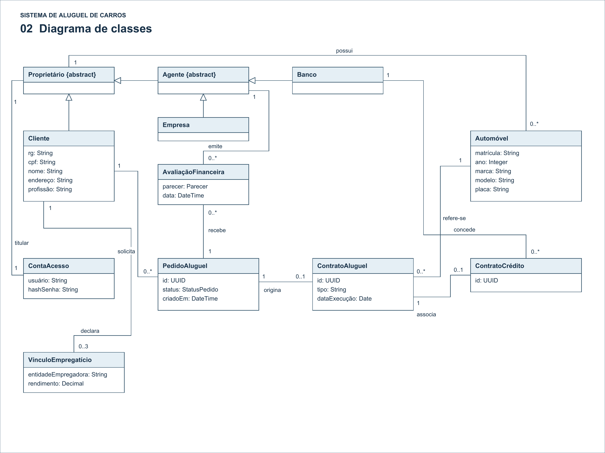
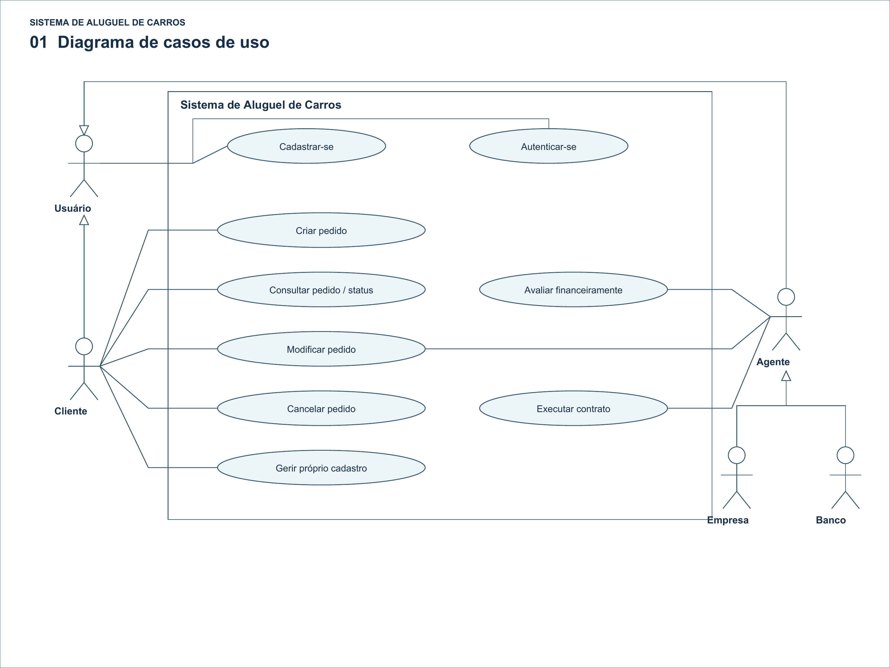
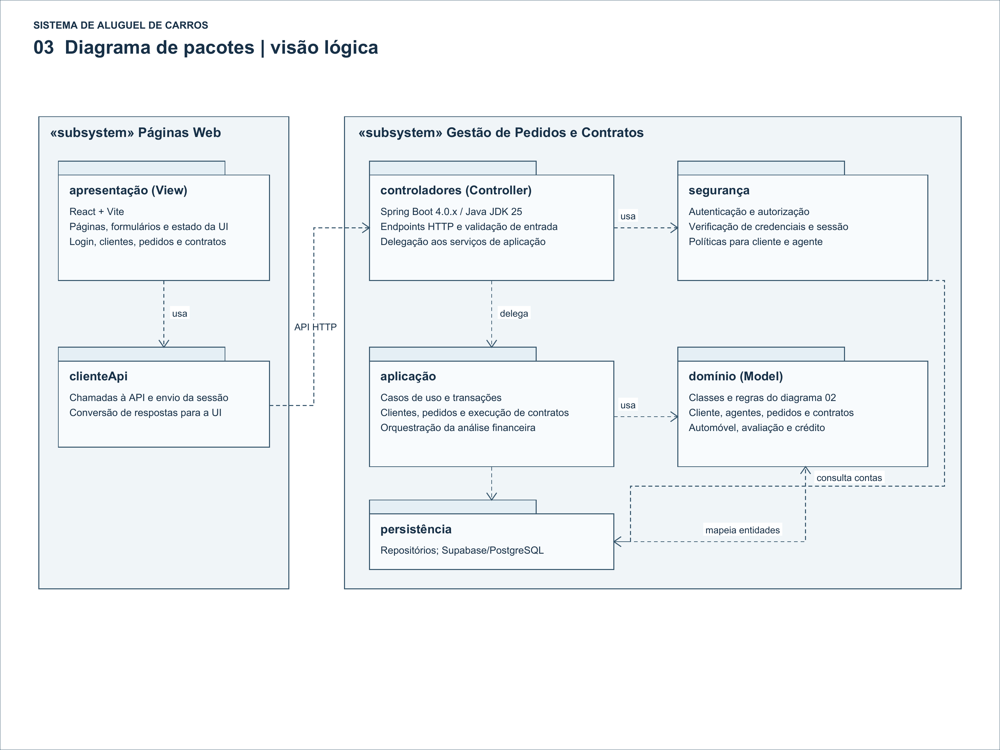

# Sistema de Aluguel de Carros: histórias e requisitos

## Requisitos rastreados

| ID | Requisito | 
|---|---|
| R1 | Cadastro prévio e autenticação obrigatória por usuário e senha; clientes e agentes acessam o sistema. | 
| R2 | Clientes introduzem, modificam, consultam e cancelam pedidos; o protótipo permite criar pedidos e visualizar seu status. | 
| R3 | Agentes, que são empresas ou bancos, modificam e avaliam financeiramente pedidos; parecer positivo permite encaminhar à consideração para executar contrato. | 
| R4 | Armazenar RG, CPF, nome, endereço, profissão e até três entidades empregadoras com respectivos rendimentos. | 
| R5 | Registrar matrícula, ano, marca, modelo e placa dos automóveis; a propriedade pode ser de cliente, empresa ou banco, conforme o tipo de contrato. | 
| R6 | O aluguel pode estar associado a contrato de crédito concedido por um banco agente. | 
| R7 | Admite-se divisão em gestão de pedidos/contratos e construção dinâmica das páginas web. | 
| R8 | Java JDK 25, Spring Boot 4.0.x, Maven, React + Vite, Supabase/PostgreSQL e arquitetura MVC. | 
| R9 | Implementar CRUD de cliente, produzir os modelos e revisá-los conforme a implementação e o feedback. | 

| ID | Decisão proposta e limite |
|---|---|
| D1 | Cadastro por autoatendimento; cliente consulta, altera e solicita exclusão do próprio cadastro. O PDF exige CRUD, mas não define o responsável ou regras de exclusão. Não foi inventado um administrador. O cadastro inicial e o login são as exceções necessárias à exigência de autenticação. Credenciamento de agentes precisa de validação antes de conceder privilégios. |
| D2 | O agente confirma a execução do contrato após parecer positivo. A expressão “à sua consideração” é ambígua; confirmar com o professor se a aceitação final é do cliente. Aprovação financeira não executa automaticamente o contrato. |
| D3 | UUIDs, datas, enumerações e transições de status são propostos. Campos comerciais não especificados (preços, prazos, juros, multas, parcelas) não foram inventados. Tipos de contrato e regras de propriedade precisam de definição posterior. |
| D4 | ContaAcesso separa credenciais dos dados de negócio, com usuário único e hash de senha. Uma conta por cliente/agente é uma simplificação; múltiplos funcionários de uma empresa exigiriam outro modelo. O pacote segurança também faz autorização por perfil. O PDF não exige JWT, Supabase Auth ou provedor específico. |
| D5 | Proprietário é uma superclasse abstrata de Cliente e Agente; Agente se especializa em Empresa e Banco. As especializações são disjuntas e completas neste escopo. Cada automóvel tem um proprietário atual; um proprietário pode ter vários automóveis. Histórico de transferências não é exigido. Ao executar contrato, validar a categoria de proprietário conforme seu tipo; a tabela de regras não consta no PDF. |
| D6 | Avaliações são entidades de histórico: cada avaliação pertence a um pedido e é emitida por um agente. Um pedido pode ter zero ou muitas avaliações. Para o protótipo, vale a avaliação mais recente posterior à última alteração relevante do pedido; empates e concorrência devem ser resolvidos transacionalmente. |
| D7 | Um pedido pertence a um cliente e origina no máximo um contrato; cada contrato deriva de um pedido e identifica um automóvel. Um automóvel pode constar em vários contratos ao longo do tempo. Isso não autoriza aluguéis simultâneos; disponibilidade e intervalos não são definidos pelo enunciado. |
| D8 | Um contrato de aluguel associa zero ou um contrato de crédito; cada crédito registrado pertence a um contrato de aluguel e foi concedido por um banco agente. A exclusividade do crédito é proposta. Não foi presumido um motor de concessão bancária ou integração com sistema bancário externo. |
| D9 | Pacotes de apresentação, cliente HTTP, controladores, aplicação, domínio, persistência e segurança organizam os dois subsistemas sugeridos. MVC é respeitado com View no React, Controller no back-end e Model no domínio/persistência. Não se trata de um diagrama de rede ou implantação. |

Os atributos apresentados são conceituais e essenciais, não um esquema completo de banco de dados. A ausência de IDs em algumas classes não dispensa identidade persistente na implementação. Nome empresarial/CNPJ, políticas de acesso dos agentes e dados detalhados do pedido devem ser validados antes do código final.

## Histórias de usuário e critérios de aceitação

### HU01 - Cadastro e autenticação 

Como usuário, quero ter um cadastro e entrar com usuário e senha para acessar as funções permitidas ao meu perfil.

- Credenciais válidas de conta cadastrada permitem acesso; credenciais inválidas não permitem.
- Sem autenticação, operações de negócio são recusadas; cadastro inicial e login permanecem acessíveis.
- Senhas são armazenadas como hash; usuário de acesso é único.

### HU02 - Gerenciar cadastro do cliente 

Como cliente, quero cadastrar, consultar, atualizar e solicitar exclusão de meus dados para manter meu cadastro.

- O cadastro contém RG, CPF, nome, endereço e profissão.
- O cliente consulta e altera apenas seus próprios dados.
- A exclusão é possível quando não há vínculos impeditivos. Para o protótipo, impedir exclusão física com pedidos/contratos vinculados, até definir retenção e eventual desativação.

### HU03 - Informar vínculos e rendimentos 

Como cliente, quero informar minhas entidades empregadoras e os rendimentos respectivos para subsidiar a análise financeira.

- Cada vínculo informa entidade empregadora e rendimento.
- O sistema aceita até três vínculos e recusa a inclusão do quarto.
- A multiplicidade mínima zero é uma decisão: o PDF não exige vínculo obrigatório.

### HU04 - Criar pedido 

Como cliente autenticado, quero criar um pedido de aluguel para submetê-lo à análise.

- O pedido fica associado ao cliente que o criou.
- O sistema atribui identificador e status EM_ANÁLISE.
- O pedido passa a aparecer na consulta do cliente; campos comerciais obrigatórios ainda precisam ser definidos.

### HU05 - Consultar pedido e status 

Como cliente, quero consultar meus pedidos e seus status para acompanhar o andamento do aluguel.

- A consulta mostra o pedido e o status atual.
- Um cliente não consulta pedidos de outro cliente.

### HU06 - Modificar pedido 

Como cliente ou agente autorizado, quero modificar um pedido para corrigir as informações da solicitação.

- Clientes modificam seus próprios pedidos; agentes atuam no escopo autorizado.
- Para o protótipo, pedido contratado ou cancelado não pode ser alterado.
- Alteração relevante invalida o parecer vigente e retorna o pedido a EM_ANÁLISE, preservando avaliações anteriores.

### HU07 - Cancelar pedido 

Como cliente, quero cancelar meu pedido para desistir da solicitação.

- Um pedido ainda não contratado pode ser marcado CANCELADO.
- Pedido cancelado deixa de ser elegível à execução do contrato.
- Cancelamento de pedido não é rescisão de contrato; rescisão não foi especificada.

### HU08 - Avaliar financeiramente 

Como agente, empresa ou banco, quero registrar um parecer financeiro para decidir se um pedido pode avançar para contratação.

- A avaliação registra pedido, agente emissor, data e parecer.
- Parecer positivo leva a APROVADO; negativo leva a REPROVADO.
- Cliente não emite avaliação financeira; avaliações anteriores permanecem no histórico.
- Aprovação habilita consideração para contratação; não cria contrato automaticamente.

### HU09 - Executar contrato 

Como agente, quero executar um contrato de aluguel aprovado para formalizar a contratação.

- Sem parecer vigente positivo, a execução é recusada.
- A execução cria um contrato vinculado ao pedido, com um automóvel e tipo de contrato, e muda o pedido para CONTRATADO.
- Não é criado um segundo contrato para o mesmo pedido.
- A categoria do proprietário deve ser compatível com o tipo de contrato. A correspondência entre tipos e categorias precisa ser fornecida, não inferida.

### HU10 - Registrar automóvel e propriedade 

Como agente que prepara o contrato, quero identificar o automóvel e seu proprietário para registrar corretamente o objeto do aluguel.

- O automóvel registra matrícula, ano, marca, modelo e placa; matrícula e placa são campos distintos.
- O proprietário é cliente, empresa ou banco.
- Esta história detalha a preparação de “Executar contrato”; não pressupõe um módulo de gestão de frota completo. A atribuição ao agente é proposta.

### HU11 - Associar crédito concedido 

Como agente que prepara o contrato, quero associar, quando houver, um contrato de crédito concedido por um banco agente para registrar o financiamento do aluguel.

- É possível executar um contrato sem crédito associado.
- Se houver crédito, o banco concedente deve ser um Banco agente cadastrado.
- Um crédito não é associado a dois contratos de aluguel nesta proposta.
- O registro não realiza nem simula a decisão de concessão de crédito bancário.

## Diagramas

### Diagrama de Classes

### Diagrama de Casos de Uso

### Diagrama de Pacotes

